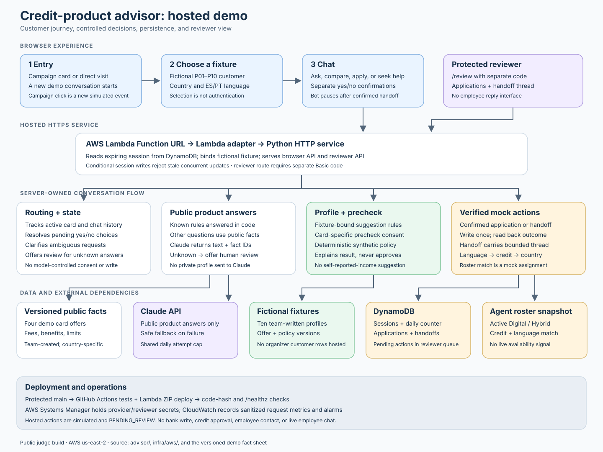

# Atlas — AI-assisted credit-card advisor

Atlas was built for the **Factored AI & Data Hackathon 2026**, a ten-day challenge to create an AI-first banking customer-service prototype. The organizer asked teams to choose one focused workflow, demonstrate normal, ambiguous, and human-required cases in **Spanish and Portuguese**, use data and tools securely, verify completed actions, and compare a learned component with a baseline. A working prototype and an honest path to production were expected; a live banking service was not. The organizer brief and data dictionaries are participant-only PDFs and are excluded from this public repository because one contains source-access credentials.

We chose **credit-product information and simulated eligibility support**. The supplied synthetic banking data covers Colombia, México, and Argentina and includes customers, products, marketing campaigns, service agents, and Spanish call transcripts. An exploratory audit found **52 credit-card campaigns** among 200 campaigns; across *all* campaigns there were 1,746,801 sends and 97,793 recorded clicks. Those counts show engagement, not card acquisitions: the data does not reliably link a campaign click to a later product conversation or contract, and its `had_conversion` flag is not a verified card opening. The same data also lacks a current card catalog and approved eligibility rules. [See the feasibility audit](docs/credit_marketing_feasibility.md).

## The proposed solution

A visitor starts from a campaign card or arrives directly, chooses a demo customer, and asks about cards in Spanish or Portuguese. Atlas can explain product terms, discuss a profile-based suggestion, run an optional card-specific **simulated precheck after consent**, and record a **mock application only after a separate confirmation**. It reads the stored application back before reporting its reference and `PENDING_REVIEW` status. For an unanswered question or a request for a person, it can confirm and queue a review packet with the conversation context and a mock specialist assignment. No employee is contacted and no credit is approved.

The team created four clearly labeled draft cards—**Campus, Horizon, Rewards, and Summit**—with country-specific versions, a [versioned offer draft](plan/card_offer_terms.md), and a [deterministic synthetic precheck policy](plan/demo_credit_policy.md). Historical campaign rows supply context for some entry cards; the named offers, the mapping, new demo clicks, policy outcomes, and applications are team-created. A campaign click or a typed customer number does not authenticate anyone.

| Layer | What it does |
| --- | --- |
| Conversation | Claude classifies fresh user intent and answers many public product questions using a versioned fact sheet; the service checks the proposed route and handles unsupported requests. |
| Service and policy | Server-bound sessions enforce fixture ownership, consent, country-specific rules, confirmation, and action read-back. The model does not set lending rules or write applications. |
| Review | A confirmed handoff stores verified context and open questions for a protected reviewer queue; assignment uses a filtered roster snapshot and does not establish live agent availability. |
| Data | Local development uses selected organizer-supplied synthetic records. The public judge build used ten separate team-written fictional customer fixtures; no organizer CSV or customer row was packaged with it. |

## What we tested and learned

- A [judge rehearsal](docs/judge_rehearsal_2026-10-02.md) covered both entry paths across three countries and two languages, plus confirmed mock-application read-back and reviewer access checks.
- A [paired local evaluation](docs/automated_evaluation_2026-10-04.md) ran a locked 20-case Spanish/Portuguese workload twice against a keyword FAQ baseline. The advisor passed 36/40 asserted journeys versus 34/40 for the baseline. These are **agent-authored, post-fix regression results**, not independent bilingual quality or production estimates; the evaluation predates the final model-first intent router.
- Later [conversation smoke checks](docs/live_conversation_checks_2026-10-04.md) found 7/8 expected outcomes. A two-card lower-cost comparison remained unreliable. Independent bilingual review and new held-out cases were not completed.

The main design choice was to keep **conversation, policy, and actions separate**. The model helps interpret questions and explain sourced product facts. Deterministic code decides whether a selected fixture can be used, applies synthetic rules, requires consent and confirmation, and verifies writes. This made the demo's limits visible: selecting a fictional persona is not real authentication; a positive precheck is not approval; the reviewer queue is not a live handoff; and the draft offers are not bank products. Real identity, approved offers and policy, independent bilingual evaluation, and an employee-service integration would be needed before customer use. [Read the release assessment](docs/release_readiness.md).

## Portfolio and local exploration

**The hackathon is over and the AWS judge app is offline.** Its Lambda reserved concurrency was set to zero, the Claude API key was disabled, and the GitHub deployment workflow was disabled. The public repository preserves the code, architecture, evaluation artifacts, and [six-slide presentation](presentation/README.md); the old judge URL is not a live demo link.

The [local browser advisor](advisor/README.md) can run from the repository root with `python3 -m advisor.web` at `http://127.0.0.1:8765/` when the participant-only source CSVs are available. Public product-answer calls also require your own `ANTHROPIC_API_KEY`; the local deterministic journey and tests are documented in the advisor guide. The [AWS deployment guide](infra/aws/README.md) describes the historical judge setup, and the [message-routing decision tree](docs/message_routing.md) explains how a chat turn is handled.

## Repository map

- [`advisor/`](advisor/README.md): browser and CLI advisor, service, policy, storage, and tests.
- [`plan/`](plan/README.md): conversation contract, campaign mapping, synthetic offers and policy, and research cases.
- [`docs/`](docs/mvp_requirements.md): requirements, data audit, architecture, evaluation, and release limits.
- [`analysis/`](analysis/evaluate_advisor_journey.py): reproducible audits and evaluation scripts.
- [`snowflake/`](snowflake/README.md): landing-table setup and read-only audit SQL, with credential placeholders.
- [`presentation/`](presentation/README.md): editable pitch deck and PDF preview.

Source CSVs, organizer PDFs, local application databases, Terraform state, and credentials are excluded from Git. The earlier [transaction-dispute concept](docs/transaction_dispute_plan.md) is archived; campaign A/B testing was deferred until after the core service.
